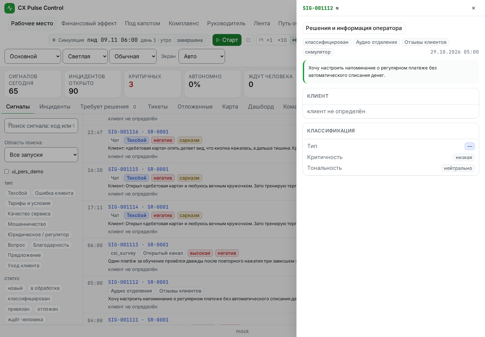
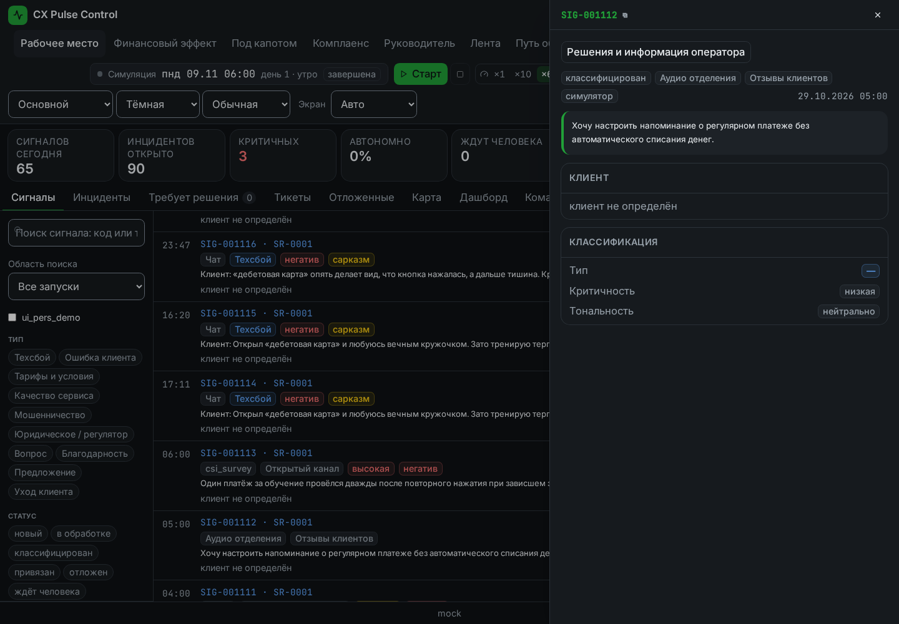
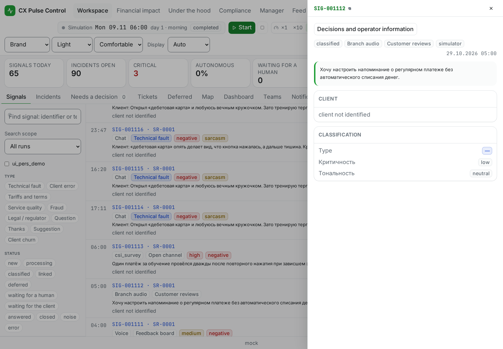
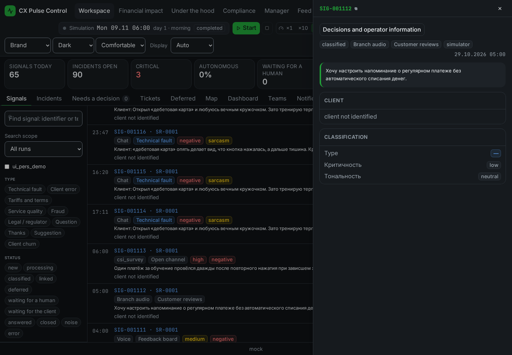

# T-240: production UI площадок — отдельное доказательство

Исходный runtime/UI: `b6c26593a9b4c3e3850ede8e68be7c770bcd2a67`. Проверка выполнена в отдельном worktree `t240-ui-proof`, без изменения кода, контрактов и seed. Это целевое UI-доказательство, а не повтор полного backend suite владельца T-240.

## Данные и границы проверки

Штатный `scripts/seed/run.py --profile lite --clients 200` создал собственную scratch БД `cx_t240_ui_revision` (PostgreSQL 16, schema `0014`, 1162 сигналов). Дополнительные строки для снимков не создавались. Из существующих первых 100 сигналов выбраны соседние `SIG-001112` (`client_voice`) и `SIG-001114` (площадка отсутствует). API `/api/signals/{id}` вернул настоящий catalog DTO для первого и `source_platform: null` для второго, без `source_url` и `_source_platform_code`.

Production `frontend/dist` обслуживался настоящим FastAPI. Preview в `APP_ENV=test` загрузил состояние Simulator без запуска акторов; chain — только Mock. Для всех соединений PostgreSQL установлен `default_transaction_read_only=on`. Защитный preview запрещал любые LLM вызовы и внешние sockets/DNS; браузер запрещал внешние запросы и методы кроме GET/HEAD. HTTP/API ответы не подменялись.

## Проверенный результат

- 4/4 браузерных сценария: ru/en × light/dark, 1440×1000.
- В `SignalsFeed` и `SignalDrawer` известная площадка подписана «Отзывы клиентов» / «Customer reviews». Бейдж не содержит ссылки, изображения, raw URL или технического `client_voice`.
- Для неизвестной площадки бейдж отсутствует как в строке, так и в drawer; обычные channel/status badges сохранены. Перед каждым итоговым снимком открывался и проверялся drawer неизвестного сигнала, затем известного. На итоговых снимках одновременно видны известный drawer, его строка и соседняя строка без площадки.
- Нет browser errors, HTTP 4xx/5xx, попыток записи, внешних обращений или LLM вызовов.
- До/после обоих браузерных проходов совпали отпечатки всех 85 public-таблиц: количество строк и digest полного содержимого, независимо от порядка строк. Digest отчёта сохранён в `proof.json`; исходные значения строк не публикуются.
- `SourcePlatformBadge.test.tsx`: 5/5 passed (2.12s). Обе production сборки `npm --prefix frontend run build` завершились успешно.

Четыре PNG просмотрены вручную после завершения штатной анимации drawer. Тексты самого корпуса остаются на языке исходных отзывов; это не утверждение о переводе пользовательского контента или всех полей существующего drawer. Проверка не запускает полный simulation/agent pipeline и не заменяет отдельные full test/coverage результаты владельца T-240.

## Снимки

Машинный отчёт: [`proof.json`](../screenshots/T-240/proof.json). Снимки и отчёт относятся к указанному source SHA, а последующий commit содержит только доказательства.
